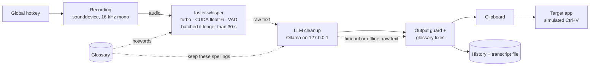

  

<h1 align="center">Hams</h1>

  <b>Local, privacy-first voice input for Windows and Linux.</b> 
  Press a hotkey, speak, and clean text appears wherever your cursor is: transcribed by Whisper on your GPU,
  polished by a local LLM, never sent to the cloud.

  
  
  
  
  
  

  
   
  Recorded in real time (only the idle pauses are trimmed). The mail window is a simple test editor; the
  dictation, the transcription (Whisper turbo on the GPU) and the cleanup (<code>qwen3.5:9b</code> in Ollama) are
  real.

  <b><a href="https://github.com/Mosaik114/hams-bachelorprojekt/releases/latest">Download Hams for Windows</a></b>
  (installer, no Python needed) · <a href="docs/user-guide.md#linux">Linux</a> ·
  <a href="docs/user-guide.md">User guide</a>

> **Use it**
> 1. Click where the text should go, press **`Ctrl+Shift+Space`**, speak, press it again: the text is pasted there.
> 2. Press **`Ctrl+Shift+Alt+Space`** instead to *Ask AI*: your spoken question goes to a local LLM, the answer is pasted.
> 3. Everything else is behind the tray icon: settings, setup assistant, help, the last five transcripts.

---

## Highlights

- **Two modes, two global hotkeys.** *Dictation* transcribes, cleans up and pastes. *Ask AI* sends what you said to
  a local LLM and pastes the answer.
- **Fully local AI pipeline.** [faster-whisper](https://github.com/SYSTRAN/faster-whisper) (CTranslate2, CUDA
  `float16`, Silero VAD, batched inference for long recordings) and a local [Ollama](https://ollama.com) for the
  cleanup. Audio and dictated text stay on the machine by default.
- **Dictate in several languages.** German, English, French, Spanish, Italian, Dutch, Polish and Portuguese, or
  *Automatic*. Switching needs no restart. All measurements below are for German only.
- **Glossary for names and jargon.** Words are passed to Whisper as hotword hints, fixed mishearings are corrected
  deterministically, and the LLM is told to leave those spellings alone.
- **Graceful degradation.** If Ollama is slow or down, the raw transcript is pasted anyway. The app falls back from
  CUDA `float16` to `int8` and on to the CPU when needed.
- **Cross-platform desktop integration.** Windows: `RegisterHotKey`, tray icon, DPI awareness, autostart.
  Linux (KDE Plasma on Wayland): XDG Desktop Portal `GlobalShortcuts`, a `uinput` virtual keyboard, a systemd user
  service.
- **Engineered like a product.** ≈1,600 test functions (≈3,200 test cases including parametrisation, many of them
  driving live Tk windows), line+branch coverage gates (93 % Windows, 88 % Linux), ruff with complexity limits, hash-locked dependencies,
  `pip-audit` and a gitleaks history scan in CI.
- **Private by design.** No account, no telemetry; logs record text *lengths*, never the dictated text. Every network
  connection Hams makes is listed in [SECURITY.md](SECURITY.md#network-connections).

## Screenshots

<table>
  <tr>
    <td align="center"> Settings</td>
    <td align="center"> Changing a shortcut</td>
    <td align="center"> Setup assistant</td>
    <td align="center"> Graphics card check</td>
    <td align="center"> Ready to dictate</td>
  </tr>
</table>

## Install

**Windows:** download `Hams-Setup-<version>.exe` from the
[latest release](https://github.com/Mosaik114/hams-bachelorprojekt/releases/latest) and run it. No Python, git or
admin rights needed. The installer is not code-signed, so SmartScreen may warn: **More info → Run anyway**. On first
start the setup assistant sets the languages, checks the graphics card, downloads the speech model, tests the
microphone and looks for Ollama; you don't need to read any docs.

**Optional, for cleanup and *Ask AI*:** install [Ollama](https://ollama.com/download), then run the setup assistant
again (*Settings → General → Setup assistant → Run again*); it downloads the default model with a progress bar. In a
terminal, `ollama pull qwen3.5:9b` does the same. Without Ollama, Hams pastes the raw transcript.

**Linux** (Kubuntu / KDE Plasma on Wayland): run `linux/install.sh` from a clone of the repository, or follow the
[user guide](docs/user-guide.md#linux) step by step.

**Something wrong?** *Settings → About & help → Diagnostic report → Create* checks the installation and opens a
report to attach to a [bug report](https://github.com/Mosaik114/hams-bachelorprojekt/issues/new/choose). The
[troubleshooting guide](docs/troubleshooting.md) covers the common problems.

## How it works

The UI and the processing run on separate threads; a single-instance lock prevents duplicate hotkey owners. More
detail: [docs/architecture.md](docs/architecture.md).

## The thesis: is local fast enough?

*Hams* (Arabic **همس**, "whisper") started as my Bachelor project at Kiel University (CAU) and is the dictation
tool I use every day. The thesis question: **can speech recognition plus LLM post-processing run fully locally,
system-wide, and fast enough for daily use?** It can: after a series of individually measured changes, the median
time from "stop speaking" to "text is in the target app" dropped from **3.09 s to 0.72 s** on real dictations. The
changes and what each one measured are listed in [docs/evaluation.md](docs/evaluation.md#the-optimisations).

The speed and memory rows come from the thesis measurements (RTX 5070, Ryzen 7 9800X3D, Windows 11, Whisper
`turbo` on CUDA, cleanup with `qwen2.5:7b`). The last two rows were measured after the thesis with today's default,
`qwen3.5:9b`, on synthetic speech.

| Metric | Before | After | Change |
|---|---:|---:|---:|
| Response time, real dictations (median, n = 172 → 678)¹ | 3.09 s | **0.72 s** | −77 % |
| Ollama cleanup call (n = 5, directly comparable) | 2.941 s | **0.839 s** | −71 % |
| Ollama status check | 4.023 s | **0.016 s** | −99.6 % |
| App import time | 1.803 s | **0.298 s** | −83 % |
| Memory after import | 505.9 MB | **74.8 MB** | −85 % |
| Hotkey ready after start | ~3 s | **0.38 s** | |
| WER without → with LLM cleanup (n = 126 × 3; v1.0.0 reached 13.32 %, before temperature 0 and the output guard) | 14.49 % | **12.12 %** | −2.4 pp |
| Cleanup outputs flagged for a changed meaning (invented digits, leaked prompt …), v1.0.0 → current | 16 / 378 | **6 / 378** | −63 % |

¹ Limited comparability: logged real use before and after, not a controlled run (other dictations, lengths and
models). [docs/evaluation.md](docs/evaluation.md#headline-results) rates each row *d* (directly comparable), *e*
(limited) or *n* (not directly comparable); this one is *e*.

**The bottleneck wasn't the model.** Taking one cleanup call apart showed that about two thirds of the wait was a
*refused IPv6 connection*: `localhost` resolved to `::1` first, Ollama only listened on IPv4, and Windows spent about
2 s before falling back. Addressing `127.0.0.1` directly fixed it; a smaller model would have saved just 0.38 s.
Methodology, limitations and raw tables: [docs/evaluation.md](docs/evaluation.md).

## How it was built

Hams was built AI-native with [Claude Code](https://claude.com/claude-code). I owned the scope, the architecture
decisions, the measurement rules and the review; the agent wrote most of the code and ran most of the measurements
under those rules. [docs/evaluation.md](docs/evaluation.md#who-ran-the-measurements) records this split, and the
thesis discloses it for the measurements. The safeguards are the ones a team would use: small reviewed changes, tests
and CI as the gate, and measured numbers instead of impressions.

The independent reviews mentioned in the changelog were Claude Code agents started with a fresh context and a fixed
review brief, from three perspectives: an end user, an engineer, and someone hiring. I triaged their findings and
decided what got fixed; there were three rounds.

## Documentation

- [User guide](docs/user-guide.md): install, first start, daily use, settings, configuration file, glossary,
  updating, Linux, uninstall, privacy
- [Troubleshooting](docs/troubleshooting.md): hotkeys, pasting, SmartScreen, GPU, Ollama, microphone, Linux, bug
  reports
- [Hardware](docs/hardware.md): requirements, measured speed per Whisper model on GPU and CPU
- [Architecture](docs/architecture.md): pipeline, threads, modules, design decisions
- [Evaluation](docs/evaluation.md): the thesis measurements, the cleanup evaluation, methodology and limitations
- [Development](docs/development.md): run from source, tests, build the installer, code layout;
  [CONTRIBUTING.md](CONTRIBUTING.md), [SECURITY.md](SECURITY.md), [CHANGELOG.md](CHANGELOG.md)

## Project history

Hams began as a single-file prototype (≈3,400 lines in `main.py`) for the thesis. It was then split into modules,
ported to Linux/Wayland and hardened for daily use. The history from that point on was imported from a private
monorepo: it contains some commits about sibling tools and commit messages in German, and a few early commits carry
normalised timestamps from squashing. It has not been rewritten. The working title was *Wisper*; everything is now
called `hams`.

## Roadmap

- Evaluate WER and LLM cleanup on real (non-synthetic) speech
- Track VRAM per process, and look into the slower Whisper model load after the CUDA preload change
- A Linux package, so Linux users don't need git and `uv`

## Acknowledgements and license

Built on [faster-whisper](https://github.com/SYSTRAN/faster-whisper), [CTranslate2](https://github.com/OpenNMT/CTranslate2),
[Ollama](https://ollama.com), [sounddevice](https://python-sounddevice.readthedocs.io) and
[pystray](https://github.com/moses-palmer/pystray). MIT License, see [LICENSE](LICENSE).
