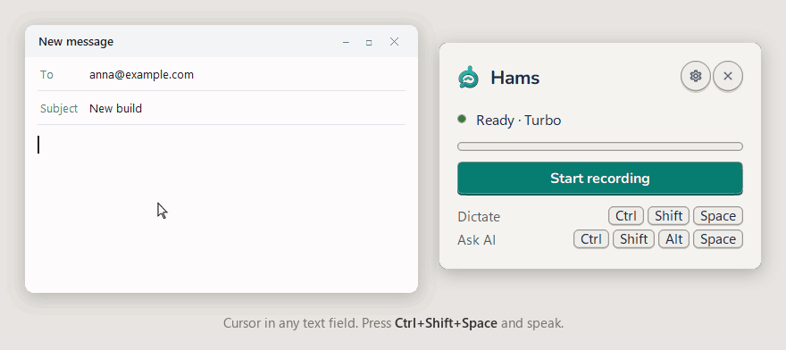
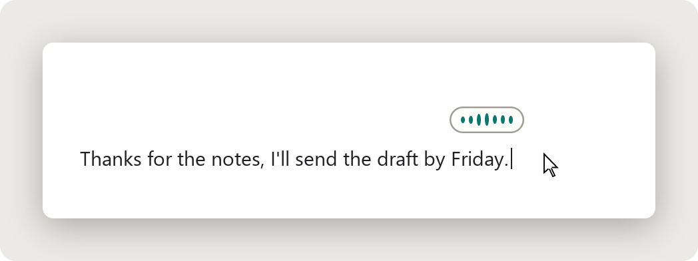
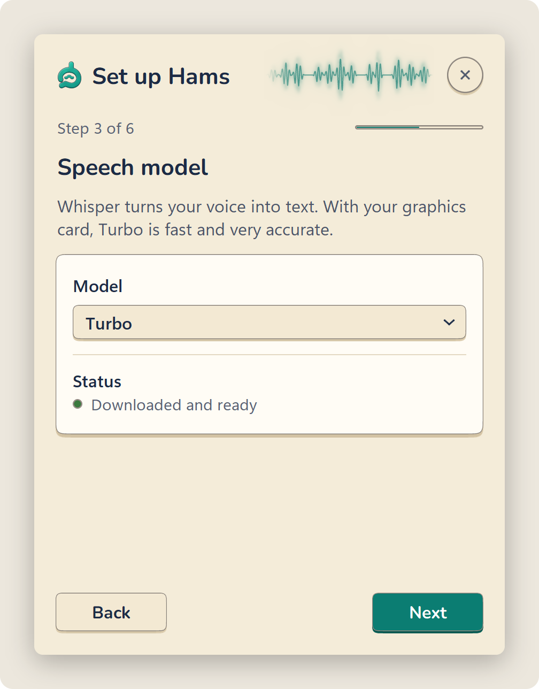
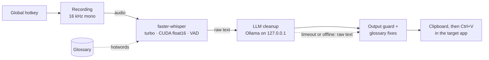
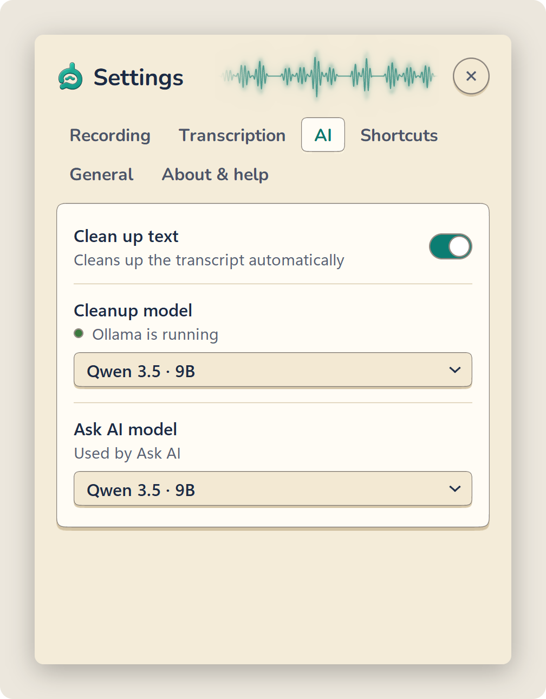
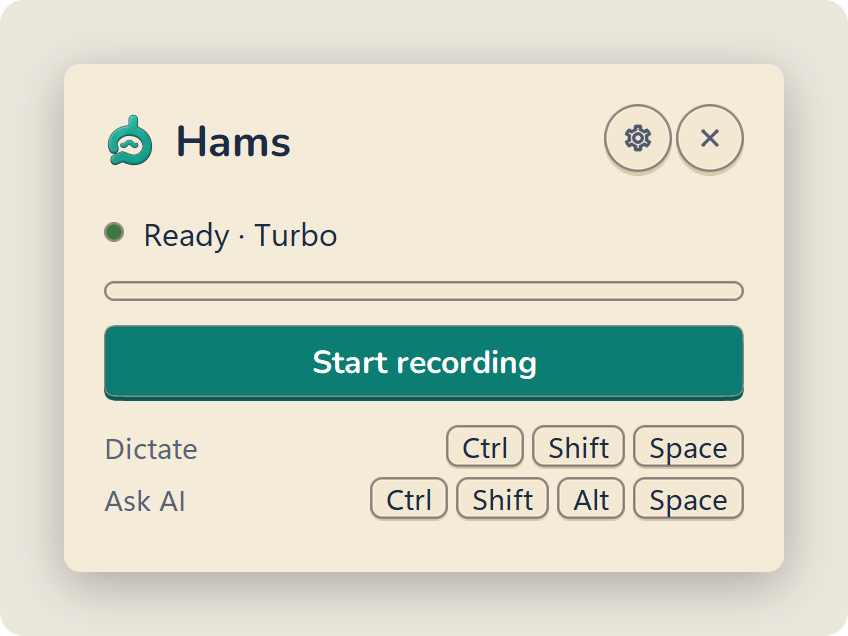

  

<h1 align="center">Hams Dictate</h1>

  <b>Local, privacy-first voice input for Windows and Linux.</b> 
  Press a hotkey, speak, and clean text appears wherever your cursor is: transcribed by Whisper on your GPU,
  polished by a local LLM, never sent to the cloud.

  
  
  
  
  

  
   
  Text and timing from a real dictation, idle pauses trimmed: filler words in, a clean sentence out.

  <b><a href="https://github.com/Mosaik114/hams-bachelorprojekt/releases/latest">Download Hams for Windows</a></b>
  (installer, no Python needed) · <a href="docs/user-guide.md#linux">Linux</a> ·
  <a href="docs/user-guide.md">User guide</a>

> **Use it**
> 1. Click where the text should go, press **`Ctrl+Shift+Space`**, speak, press it again: the text is pasted there.
> 2. Press **`Ctrl+Shift+Alt+Space`** instead to *Ask AI*: your spoken question goes to a local LLM, the answer is pasted.
> 3. Everything else is behind the tray icon: settings, setup assistant, help, the last five transcripts.

## Highlights

- **Two modes, two global hotkeys.** *Dictation* transcribes, cleans up and pastes; *Ask AI* pastes the answer of a
  local LLM.
- **Fully local.** [faster-whisper](https://github.com/SYSTRAN/faster-whisper) on the GPU (or CPU) and
  [Ollama](https://ollama.com) for the cleanup. No account, no telemetry; logs record text lengths, never the text.
- **Ten dictation languages and a glossary.** German, English, French, Spanish, Italian, Dutch, Polish, Portuguese,
  Turkish, Arabic or *Automatic*; names and jargon keep their spelling. The glossary is edited right in the app.
- **Seven interface languages.** German, English, Russian, Spanish, French, Arabic (right to left) and Turkish, or
  *Automatic*, which follows Windows.
- **One-click updates** (Windows). *Update now* downloads the new setup, checks it against the release's SHA-256
  file, installs it silently and starts Hams again, never in the middle of a dictation.
- **Level at the pointer** (Windows). While you dictate, a small level pill follows the mouse, so you see that Hams is
  listening without looking for its window.
- **Fails soft.** If Ollama is slow or offline, the raw transcript is pasted anyway; without a suitable GPU,
  Whisper runs on the CPU.

 The level pill beside the pointer while dictating.

## For reviewers

If you have five minutes, this is what the project shows:

| | Where to look |
|---|---|
| **Measured result:** median response time 3.09 s → 0.72 s, each change measured on its own | [Evaluation](docs/evaluation.md#headline-results), [where the time went](docs/evaluation.md#where-the-time-went) |
| **Testing:** ≈2,000 test functions, many driving the real Tk app; line + branch coverage gates (93 % Windows, 88 % Linux) | [Quality gates](docs/architecture.md#quality-gates), [CI runs](https://github.com/Mosaik114/hams-bachelorprojekt/actions/workflows/ci.yml) |
| **Architecture:** threaded pipeline, no `torch`, graceful fallbacks, decisions with the rejected alternative | [Design decisions](docs/architecture.md#design-decisions) |
| **Working with AI agents:** I set scope, architecture and measurement rules; Claude Code wrote most of the code | [How it was built](#how-it-was-built), [review log](docs/reviews.md) |
| **Shipping:** installer built in CI with signed build provenance, silent-install smoke test, user docs | [Releases](https://github.com/Mosaik114/hams-bachelorprojekt/releases), [user guide](docs/user-guide.md) |

Built by **Mazgin A. Ahmad**, business informatics student at Kiel University (CAU) ·
[GitHub profile](https://github.com/Mosaik114)

## Install

**Windows 10/11:** download `Hams-Setup-<version>.exe` from the
[latest release](https://github.com/Mosaik114/hams-bachelorprojekt/releases/latest) and run it. No Python, git or
admin rights needed. An NVIDIA GPU is recommended, not required; plan for about 4 GB of disk with the GPU model
([requirements](docs/hardware.md#requirements)). The installer is not code-signed, so SmartScreen may warn:
**More info → Run anyway**.

**Verify the download:** every release has `Hams-Setup-<version>.exe.sha256` next to the installer (compare with
`Get-FileHash Hams-Setup-<version>.exe`; *Update now* in the app does exactly that and refuses anything that does
not match), and every installer carries a build provenance attestation from CI:
`gh attestation verify Hams-Setup-<version>.exe --repo Mosaik114/hams-bachelorprojekt`.

On first start, a setup assistant picks the languages, checks the graphics card, downloads the speech model, tests
the microphone and looks for Ollama.

 The setup assistant downloads the speech model that suits your hardware.

**Optional, for cleanup and *Ask AI*:** install [Ollama](https://ollama.com/download) and run the setup assistant
again (*Settings → General → Setup assistant*); it downloads the default model (or run `ollama pull qwen3.5:9b`).
Without Ollama, Hams pastes the raw transcript.

**Linux** (KDE Plasma on Wayland): run `linux/install.sh` from a clone, or follow the
[user guide](docs/user-guide.md#linux).

**Something wrong?** See [troubleshooting](docs/troubleshooting.md); *Settings → About & help → Diagnostic report*
prepares a [bug report](https://github.com/Mosaik114/hams-bachelorprojekt/issues/new/choose).

## How it works

Recording, transcription and cleanup run off the UI thread. If the LLM answer changes digits, leaks the prompt or
drops most words, an output guard pastes the raw transcript instead. Details: [architecture](docs/architecture.md).

 Local AI cleanup with the Ollama model of your choice.

## The thesis: is local fast enough?

*Hams* (Arabic **همس**, "whisper") started as my Bachelor project at Kiel University (CAU) and is the dictation tool
I use every day. The question: **can speech recognition plus LLM post-processing run fully locally, system-wide,
and fast enough for daily use?** It can. Measured on an RTX 5070 with Whisper `turbo` and a 7B cleanup model:

| Metric | Before | After |
|---|---:|---:|
| Response time, real dictations (median)¹ | 3.09 s | **0.72 s** |
| Ollama cleanup call | 2.941 s | **0.839 s** |
| Hotkey ready after start | ~3 s | **0.38 s** |
| Memory after import | 505.9 MB | **74.8 MB** |

¹ Logged real use before and after (n = 172 → 678), not a controlled run. Every row is rated for comparability
in the [evaluation](docs/evaluation.md#headline-results), together with word error rates and cleanup quality.

**The bottleneck wasn't the model.** About two thirds of each cleanup call was a refused IPv6 connection:
`localhost` resolved to `::1` first, Ollama only listened on IPv4, and Windows waited about 2 s before falling back.
Addressing `127.0.0.1` directly fixed it; a smaller model would have saved just 0.38 s.

## How it was built

Hams was built AI-native with [Claude Code](https://claude.com/claude-code). I owned the scope, the architecture
decisions, the measurement rules and the review; the agent wrote most of the code and ran most of the measurements
under those rules ([who ran what](docs/evaluation.md#who-ran-the-measurements)). The safeguards are the ones a team
would use: small reviewed changes, tests and CI as the gate, measured numbers instead of impressions. Three
structured review rounds by AI agents followed; I triaged every finding ([review log](docs/reviews.md)).

Besides `127.0.0.1` over a smaller model, two decisions against an alternative I turned down:

- **No `torch`:** cuBLAS/cuDNN come from the NVIDIA wheels, saving 1.6 s per start and 4.3 GB on disk
  ([architecture](docs/architecture.md#design-decisions)).
- **A guard that pastes the raw text** instead of repairing a bad LLM answer, with cleanup at temperature 0
  ([evaluation](docs/evaluation.md#llm-cleanup-quality)).

## Documentation

- [User guide](docs/user-guide.md): install, daily use, settings, glossary, Linux, privacy
- [Troubleshooting](docs/troubleshooting.md): hotkeys, pasting, SmartScreen, GPU, Ollama, microphone
- [Hardware](docs/hardware.md): requirements and measured speed per Whisper model
- [Architecture](docs/architecture.md) and [evaluation](docs/evaluation.md): design, measurements, limitations
- [Development](docs/development.md): run from source, tests, build the installer, project history
- [Contributing](CONTRIBUTING.md) · [Security](SECURITY.md) · [Changelog](CHANGELOG.md) ·
  [Code of conduct](.github/CODE_OF_CONDUCT.md)

**Roadmap:** evaluate WER and cleanup on real (non-synthetic) speech, track VRAM per process, and ship a Linux
package so Linux users don't need git.

More screenshots

 The main window: status, record button and both shortcuts.

## Acknowledgements and license

Built on [faster-whisper](https://github.com/SYSTRAN/faster-whisper), [CTranslate2](https://github.com/OpenNMT/CTranslate2),
[Ollama](https://ollama.com), [sounddevice](https://python-sounddevice.readthedocs.io) and
[pystray](https://github.com/moses-palmer/pystray). MIT License, see [LICENSE](LICENSE).
