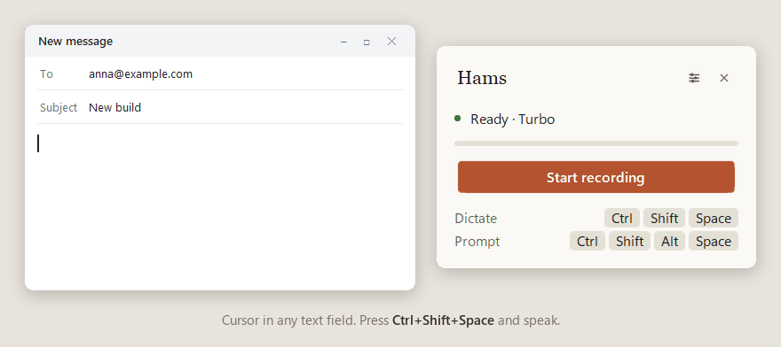
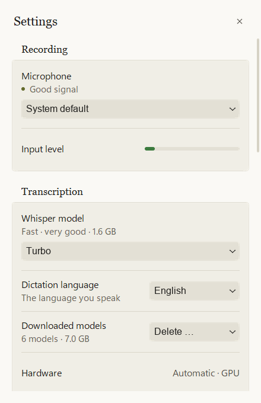
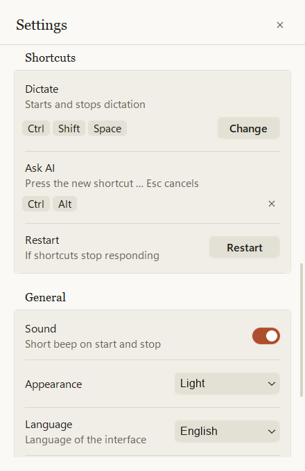
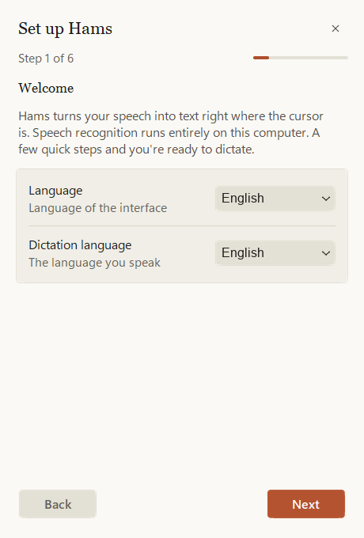
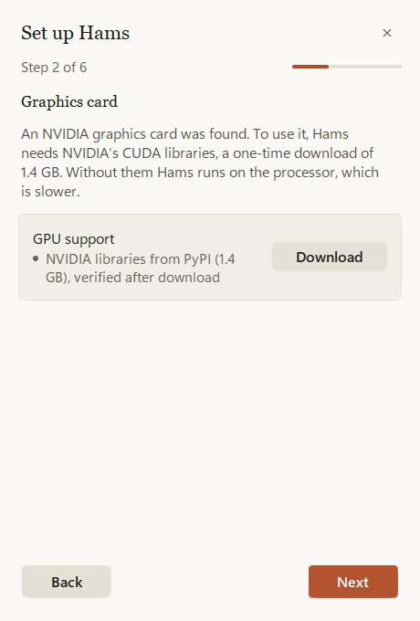
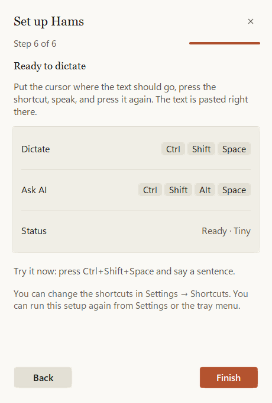
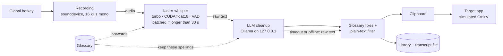

<p align="center">
  
</p>

<h1 align="center">Hams</h1>

<p align="center">
  <b>Local, privacy-first voice input for Windows and Linux.</b><br>
  Press a hotkey, speak, and clean text appears wherever your cursor is: transcribed by Whisper on your GPU,
  polished by a local LLM, never sent to the cloud.
</p>

<p align="center">
  <a href="https://github.com/Mosaik114/hams-bachelorprojekt/actions/workflows/ci.yml"></a>
  <a href="https://github.com/Mosaik114/hams-bachelorprojekt/actions/workflows/secrets.yml"></a>
  
  
  
  <a href="LICENSE"></a>
</p>

<p align="center">
  
  <br>
  <sub>Recorded in real time (only the idle pauses are trimmed). The mail window is a simple test editor; the
  dictation, the transcription (Whisper turbo on the GPU) and the cleanup (<code>qwen3.5:9b</code> in Ollama) are
  real.</sub>
</p>

<p align="center">
  <b><a href="https://github.com/Mosaik114/hams-bachelorprojekt/releases/latest">Download Hams for Windows</a></b>
  (installer, no Python needed) · <a href="docs/user-guide.md#linux">Linux</a> ·
  <a href="docs/user-guide.md">User guide</a>
</p>

---

## Highlights

- **Two modes, two global hotkeys.** *Dictation* transcribes, cleans up and pastes. *Ask AI* (prompt mode) sends
  what you said to a local LLM and pastes the answer.
- **Fully local AI pipeline.** [faster-whisper](https://github.com/SYSTRAN/faster-whisper) (CTranslate2, CUDA
  `float16`, Silero VAD, batched inference for long recordings) and [Ollama](https://ollama.com) for the cleanup.
  Audio and text never leave the machine.
- **Dictate in several languages.** German, English, French, Spanish, Italian, Dutch, Polish and Portuguese, or
  *Automatic*, where Whisper detects the language of each recording. Switching needs no restart: the models are
  multilingual, only the instructions to Whisper and the LLM change. All measurements below are for German only.
- **Glossary for names and jargon.** Words are passed to Whisper as hotword hints, fixed mishearings are corrected
  deterministically, and the LLM is told to leave those spellings alone. Edits apply live, without a restart.
- **Graceful degradation.** If Ollama is slow or down, the raw transcript is pasted anyway. The app falls back from
  CUDA `float16` to `int8` and on to the CPU when needed.
- **Cross-platform desktop integration.** Windows: `RegisterHotKey`, tray icon, DPI awareness, autostart.
  Linux (KDE Plasma on Wayland): XDG Desktop Portal `GlobalShortcuts`, a `uinput` virtual keyboard for pasting,
  a systemd user service.
- **Engineered like a product.** About 1,600 tests (including live Tk windows), an 85 % coverage gate, ruff with
  complexity limits, hash-locked dependencies, `pip-audit` and a gitleaks history scan in CI.
- **Private by design.** Logs record text *lengths*, never the dictated text. Plain-HTTP Ollama is only accepted
  on the local machine; a remote endpoint must use HTTPS.

## Screenshots

<table>
  <tr>
    <td align="center"><br><sub>Settings</sub></td>
    <td align="center"><br><sub>Changing a shortcut</sub></td>
    <td align="center"><br><sub>First-run wizard</sub></td>
    <td align="center"><br><sub>Graphics card check</sub></td>
    <td align="center"><br><sub>Ready to dictate</sub></td>
  </tr>
</table>

## Install (Windows)

1. Download `Hams-Setup-<version>.exe` from the [latest release](https://github.com/Mosaik114/hams-bachelorprojekt/releases/latest)
   and double-click it. No Python, git or admin rights needed: Hams installs for your user only, to
   `%LOCALAPPDATA%\Programs\Hams`, with a Start menu entry and (optional) autostart.
2. The installer is not code-signed, so Windows SmartScreen may warn about an unknown publisher. Click
   **More info → Run anyway**.
3. Optional, for the LLM cleanup and *Ask AI*: install [Ollama](https://ollama.com/download), then run the setup
   assistant again (*Settings → General → Setup assistant → Run again*). It finds Ollama and downloads the default
   model with a progress bar; *Settings → AI* has the same download button. Without Ollama, Hams pastes the raw
   transcript.

**First start.** A short setup assistant opens and walks you through the rest; you don't need to read any docs.
It sets the interface and dictation language, checks for an NVIDIA graphics card, downloads a speech model with a
progress bar (Turbo, 1.6 GB, with a GPU; Small, 486 MB, on the CPU), lets you pick and test the microphone, checks
whether Ollama is running (cleanup stays off if it isn't, and Hams works fine without it) and shows the shortcuts.
Every download can be cancelled and retried.

With an NVIDIA GPU, the assistant offers the CUDA libraries Hams needs (cuBLAS, cuDNN and NVRTC from PyPI, a
one-time download of 1.37 GB, about 2 GB unpacked). The installer does not include them because they are useless
without an NVIDIA card. The download is checked against pinned SHA-256 hashes and can be resumed.

**Updating:** download the new setup and run it; your settings are kept. Hams tells you when a new version is out
([details](docs/user-guide.md#updating-hams)). **Self-test:** `Hams.exe` is a windowed program and prints nothing to
a console, so let it write a report:

```powershell
Start-Process -Wait "$env:LOCALAPPDATA\Programs\Hams\Hams.exe" -ArgumentList "--self-test --report $env:TEMP\hams-self-test.txt"
notepad $env:TEMP\hams-self-test.txt
```

Uninstall from Windows Settings → Apps.

### Linux

Hams runs on Linux too (made for Kubuntu / KDE Plasma on Wayland, apt-based). There is no installer yet; the
[user guide](docs/user-guide.md#linux) walks through cloning the repository, the one-time system setup
(`linux/setup-system.sh`), installing with `uv` and autostart, step by step.

<details>
<summary><b>How the Linux port differs from Windows</b></summary>

| | Windows | Linux |
|---|---|---|
| Global hotkeys | `RegisterHotKey` | XDG Desktop Portal `GlobalShortcuts` (KDE asks once) |
| Paste | `keyboard` library | own virtual keyboard via `/dev/uinput` (Wayland blocks synthetic input otherwise) |
| Sound | `winsound` | soft synthesised chime via `sounddevice` |
| Config | `%APPDATA%\Hams\config.toml` | `~/.config/hams/config.toml` (or `$XDG_CONFIG_HOME/hams`) |
| Autostart | registry `Run` key | `~/.config/autostart` + systemd user service |
| Bring to front | tray icon, or start Hams again | `linux/show-hams.sh` (bind it to a key or panel button), or start Hams again |

</details>

### From source (developers)

Requirements: Windows 10/11 or Linux, Python 3.10+, an NVIDIA GPU for the default settings (the CPU works too,
just slower), and optionally [Ollama](https://ollama.com/download).

```powershell
git clone https://github.com/Mosaik114/hams-bachelorprojekt.git
cd hams-bachelorprojekt
python -m venv .venv
.venv\Scripts\Activate.ps1
pip install -e ".[cuda]"     # [cuda] adds cuBLAS + cuDNN without pulling in torch
ollama pull qwen3.5:9b       # default cleanup and prompt model; any Ollama model works
hams
```

On first start, the setup assistant downloads the speech model (Turbo, 1.6 GB, with a GPU). For exactly the versions
that CI tests, install with hashes: `pip install --require-hashes -r requirements.txt` and then
`pip install --no-deps -e .`.

| Hotkey | Mode | Pipeline |
|---|---|---|
| `Ctrl+Shift+Space` | Dictation | record → Whisper → LLM cleanup → paste |
| `Ctrl+Shift+Alt+Space` | Ask AI (prompt mode) | record → Whisper → LLM answer → paste |

Press the same hotkey again to stop recording. Autostart: `python hams/setup_autostart.py` (remove with `--remove`). It registers
`scripts/start_hams.vbs`, which starts Hams without a console window. `scripts/build_launcher.cmd` builds an
optional `Hams.exe` that opens the settings of the running instance.

## Documentation

- [User guide](docs/user-guide.md): install, first start, daily use, settings, configuration file, glossary,
  updating, Linux, uninstall, privacy
- [Hardware](docs/hardware.md): requirements, measured speed per Whisper model on GPU and CPU, recommendations
- [Troubleshooting](docs/troubleshooting.md): hotkeys, pasting, SmartScreen, GPU, Ollama, microphone, bug reports
- [Architecture](docs/architecture.md): pipeline, threads, modules, design decisions
- [Evaluation](docs/evaluation.md): the thesis measurements, methodology and limitations

## Configuration

Almost everything can be changed in the settings window. The rest lives in `config.toml`
(`%APPDATA%\Hams` on Windows, `~/.config/hams` on Linux); every key and its default is documented in
[`hams/config.default.toml`](hams/config.default.toml). The [user guide](docs/user-guide.md#the-configuration-file)
has the reference: hotkeys, model and fallback chain, dictation language, cleanup prompts, update check, and the
glossary.

## How it works



The UI and the processing run on separate threads. A single-instance lock prevents duplicate hotkey owners.
Configuration is layered: code defaults, then the shipped [`config.default.toml`](hams/config.default.toml), then
the user file. More detail: [docs/architecture.md](docs/architecture.md).

## The thesis: is local fast enough?

*Hams* (Arabic **همس**, "whisper") started as my Bachelor project at Kiel University (CAU) and is the dictation
tool I use every day. The thesis question was simple: **can speech recognition plus LLM post-processing run fully
locally, system-wide, and fast enough for daily use?** It can: after twelve individually measured optimisations,
the median time from "stop speaking" to "text is in the target app" dropped from **3.09 s to 0.72 s** on real
dictations.

## Measured results

The speed and memory rows come from the thesis measurements (RTX 5070, Ryzen 7 9800X3D, Windows 11, Whisper `turbo`
on CUDA, cleanup with `qwen2.5:7b`, the model used at the time). The last two rows were measured after the thesis on
the same machine with today's default, `qwen3.5:9b`, on synthetic speech. Methodology, limitations and raw tables:
[docs/evaluation.md](docs/evaluation.md).

| Metric | Before | After | Change |
|---|---:|---:|---:|
| Response time, real dictations (median, n = 172 → 678) | 3.09 s | **0.72 s** | −77 % |
| Ollama cleanup call (n = 5, directly comparable) | 2.941 s | **0.839 s** | −71 % |
| Ollama status check | 4.023 s | **0.016 s** | −99.6 % |
| App import time | 1.803 s | **0.298 s** | −83 % |
| Memory after import | 505.9 MB | **74.8 MB** | −85 % |
| Hotkey ready after start | ~3 s | **0.38 s** | |
| WER without → with LLM cleanup (n = 126 × 3; v1.0.0 reached 13.32 %, before temperature 0 and the output guard) | 14.49 % | **12.12 %** | −2.4 pp |
| Cleanup outputs flagged for a changed meaning (invented digits, leaked prompt …), v1.0.0 → current | 16 / 378 | **6 / 378** | −63 % |

**The interesting part: the bottleneck wasn't the model.** Taking one cleanup call apart showed that about two thirds
of the wait was a *refused IPv6 connection*. `localhost` resolved to `::1` first, Ollama only listened on IPv4, and
Windows spent about 2 s before falling back. Addressing `127.0.0.1` directly fixed it; switching to a smaller model
would have saved just 0.38 s.

Other findings from the WER benchmark (`tools/wer_benchmark.py`, 80 synthetic samples, clean and at 20/10/5 dB SNR):

- `int8_float16` matched `float16` on WER (both 12.90 %) and was 8 % faster. `float16` stayed the default as a
  precaution.
- Batched inference pays off only above about 30 s of audio: **26–45 % faster and 1.3–2.7 points lower WER** on
  long recordings, where sequential decoding started dropping words.
- Removing an accidental `torch` dependency (CTranslate2 only needs cuBLAS and cuDNN) shrank the environment from
  6.6 GB to 2.3 GB.

## Development

```powershell
pip install --require-hashes -r requirements-dev.txt
pip install --no-deps -e .
pytest tests --cov=hams       # about 1,600 tests; Tk tests open real windows
ruff check . ; ruff format --check .
```

The Windows installer is built from a clean environment without the `[cuda]` extra. The frozen app comes from
PyInstaller (onedir), and Inno Setup turns it into `build\installer\Hams-Setup-<version>.exe`:

```powershell
.\packaging\build.ps1 -InstallDependencies -Installer   # needs Inno Setup 6 for -Installer
Start-Process -Wait build\dist\Hams\Hams.exe -ArgumentList "--self-test --report build\self-test.txt"
```

CI builds the installer on every push. It installs the result silently, runs `--self-test`, uninstalls it, and checks
that nothing is left. On a `v*` tag, CI also attaches the installer to the GitHub release.

```
hams/
├── main.py              entry point: config, single instance, Tk root
├── app.py               main window, composed from the mixins below
├── recording.py         microphone → audio buffer, level meter (dBFS)
├── transcription.py     Whisper, glossary, Ollama cleanup, paste
├── cleanup_guard.py     checks the cleanup answer, falls back to the raw text
├── whisper_model.py     load, switch and download models with fallback
├── backend_preload.py   load CUDA libs without torch (−1.5 s per start)
├── gpu_support.py       on-demand CUDA download for the installed app
├── cli.py, self_test.py command line: --self-test, --install-gpu-support
├── glossary.py          hotwords, fixed corrections, live reload
├── ollama.py            local Ollama status and model list
├── system_hotkeys.py    Windows hotkeys     │ portal_hotkeys.py  Linux hotkeys
├── linux.py             uinput paste, chime, signals, lock file
├── settings_*.py        settings window, sections, live status, model manager
├── config*.py           layered TOML config, validation, persistence
├── i18n.py              interface language; strings in messages_en.py / messages_de.py
├── dictation_language.py  dictation language: Whisper hints and Ollama instructions per language
└── ui_kit/              a small design system for tkinter (theme, DPI scaling, controls, icons)
scripts/                 Windows start script and settings launcher
packaging/               PyInstaller spec, Inno Setup script, build and smoke test
linux/                   system setup and bring-to-front helper for Linux
tools/wer_benchmark.py   reproducible WER and latency benchmark (needs GPU and Windows TTS)
```

The codebase is about 10.5k lines of application code and 12k lines of tests. CI rules: no function with a
cyclomatic complexity above 10, and the coverage gate fails the build below 85 %.

## Project history

Hams began as a single-file prototype (≈3,400 lines in `main.py`) for the thesis. It was then split into the
modules above, ported to Linux/Wayland and hardened for daily use: standby-proof hotkeys, single-instance restart,
hash-locked dependencies. The commit history from that point on is preserved here; it was imported
from a private monorepo, which is why the early commit messages are in German. [CHANGELOG.md](CHANGELOG.md) lists
the user-visible changes.

The working title was *Wisper*; the package, the config folder and all other identifiers are now called
`hams`. See [CONTRIBUTING.md](CONTRIBUTING.md) for the development setup.

## Roadmap

- Evaluate WER and LLM cleanup on real (non-synthetic) speech; on synthetic speech the cleanup is measured in
  [docs/evaluation.md](docs/evaluation.md#llm-cleanup-quality)
- Track VRAM per process, and look into the slower Whisper model load after the CUDA preload change
- A Linux package, so Linux users don't need git and `uv`

## Acknowledgements and license

Built on [faster-whisper](https://github.com/SYSTRAN/faster-whisper), [CTranslate2](https://github.com/OpenNMT/CTranslate2),
[Ollama](https://ollama.com), [sounddevice](https://python-sounddevice.readthedocs.io) and
[pystray](https://github.com/moses-palmer/pystray). AI coding assistants were part of the development workflow;
the thesis documents which measurements were run with their help.

MIT License, see [LICENSE](LICENSE).
