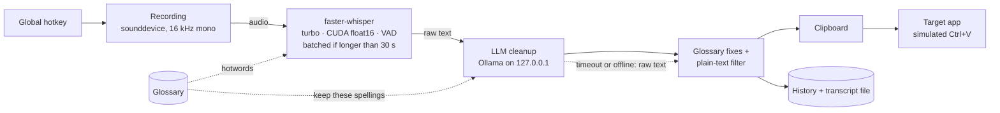

<p align="center">
  
</p>

<h1 align="center">Hams</h1>

<p align="center">
  <b>Local, privacy-first voice input for Windows and Linux.</b><br>
  Press a hotkey, speak, and clean text appears wherever your cursor is: transcribed by Whisper on your GPU,
  polished by a local LLM, never sent to the cloud.
</p>

<p align="center">
  <a href="https://github.com/Mosaik114/hams-bachelorprojekt/actions/workflows/ci.yml"></a>
  <a href="https://github.com/Mosaik114/hams-bachelorprojekt/actions/workflows/secrets.yml"></a>
  
  
  
  <a href="LICENSE"></a>
</p>

---

*Hams* (Arabic **همس**, "whisper") started as my Bachelor project at Kiel University (CAU) and is the dictation
tool I use every day. The thesis question was simple: **can speech recognition plus LLM post-processing run fully
locally, system-wide, and fast enough for daily use?** It can: after twelve individually measured optimisations,
the median time from "stop speaking" to "text is in the target app" dropped from **3.09 s to 0.72 s** on real
dictations.

## Highlights

- **Two modes, two global hotkeys.** *Dictation* transcribes, cleans up and pastes. *Prompt mode* sends what you
  said to a local LLM and pastes the answer.
- **Fully local AI pipeline.** [faster-whisper](https://github.com/SYSTRAN/faster-whisper) (CTranslate2, CUDA
  `float16`, Silero VAD, batched inference for long recordings) and [Ollama](https://ollama.com) for the cleanup.
  Audio and text never leave the machine.
- **Glossary for names and jargon.** Words are passed to Whisper as hotword hints, fixed mishearings are corrected
  deterministically, and the LLM is told to leave those spellings alone. Edits apply live, without a restart.
- **Graceful degradation.** If Ollama is slow or down, the raw transcript is pasted anyway. The app falls back from
  CUDA `float16` to `int8` and on to the CPU when needed.
- **Cross-platform desktop integration.** Windows: `RegisterHotKey`, tray icon, DPI awareness, autostart.
  Linux (KDE Plasma on Wayland): XDG Desktop Portal `GlobalShortcuts`, a `uinput` virtual keyboard for pasting,
  a systemd user service.
- **Engineered like a product.** About 1,600 tests (including live Tk windows), an 85 % coverage gate, ruff with
  complexity limits, hash-locked dependencies, `pip-audit` and a gitleaks history scan in CI.
- **Private by design.** Logs record text *lengths*, never the dictated text. Plain-HTTP Ollama is only accepted
  on the local machine; a remote endpoint must use HTTPS.

## How it works



The UI and the processing run on separate threads. A single-instance lock prevents duplicate hotkey owners.
Configuration is layered: code defaults, then the shipped [`config.default.toml`](wisper/config.default.toml), then
the user file. More detail: [docs/architecture.md](docs/architecture.md).

## Measured results

All numbers come from the thesis measurements (RTX 5070, Ryzen 7 9800X3D, Windows 11, Whisper `turbo` on CUDA,
cleanup with `qwen2.5:7b`). Methodology, limitations and raw tables: [docs/evaluation.md](docs/evaluation.md).

| Metric | Before | After | Change |
|---|---:|---:|---:|
| Response time, real dictations (median, n = 172 → 678) | 3.09 s | **0.72 s** | −77 % |
| Ollama cleanup call (n = 5, directly comparable) | 2.941 s | **0.839 s** | −71 % |
| Ollama status check | 4.023 s | **0.016 s** | −99.6 % |
| App import time | 1.803 s | **0.298 s** | −83 % |
| Memory after import | 505.9 MB | **74.8 MB** | −85 % |
| Hotkey ready after start | ~3 s | **0.38 s** | |

**The interesting part: the bottleneck wasn't the model.** Taking one cleanup call apart showed that about two thirds
of the wait was a *refused IPv6 connection*. `localhost` resolved to `::1` first, Ollama only listened on IPv4, and
Windows spent about 2 s before falling back. Addressing `127.0.0.1` directly fixed it; switching to a smaller model
would have saved just 0.38 s.

Other findings from the WER benchmark (`tools/wer_messung.py`, 80 synthetic samples, clean and at 20/10/5 dB SNR):

- `int8_float16` matched `float16` on WER (both 12.90 %) and was 8 % faster. `float16` stayed the default as a
  precaution.
- Batched inference pays off only above about 30 s of audio: **26–45 % faster and 1.3–2.7 points lower WER** on
  long recordings, where sequential decoding started dropping words.
- Removing an accidental `torch` dependency (CTranslate2 only needs cuBLAS and cuDNN) shrank the environment from
  6.6 GB to 2.3 GB.

## Quick start (Windows)

Requirements: Windows 10/11, Python 3.10+, an NVIDIA GPU for the default settings (the CPU works too, just slower),
and [Ollama](https://ollama.com/download).

```powershell
git clone https://github.com/Mosaik114/hams-bachelorprojekt.git
cd hams-bachelorprojekt
python -m venv .venv
.venv\Scripts\Activate.ps1
pip install -e ".[cuda]"     # [cuda] adds cuBLAS + cuDNN without pulling in torch
ollama pull qwen3.5:9b       # default cleanup and prompt model; any Ollama model works
hams
```

On first start, faster-whisper downloads the `turbo` model (about 1.5 GB). For exactly the versions that CI tests,
install with hashes: `pip install --require-hashes -r requirements.txt` and then `pip install --no-deps -e .`.

| Hotkey | Mode | Pipeline |
|---|---|---|
| `Ctrl+Shift+Space` | Dictation | record → Whisper → LLM cleanup → paste |
| `Ctrl+Shift+Alt+Space` | Prompt | record → Whisper → LLM answer → paste |

Press the same hotkey again to stop recording. Autostart: `python wisper/setup_autostart.py` (remove with `--remove`).

<details>
<summary><b>Linux (Kubuntu / KDE Plasma on Wayland)</b></summary>

```bash
sudo bash linux/system-einrichten.sh        # once: Tk, audio, clipboard, NVIDIA driver, uinput permission; then reboot
uv venv --system-site-packages --python /usr/bin/python3 .venv
uv pip install --python .venv/bin/python -e ".[cuda,dev]"
.venv/bin/python wisper/setup_autostart.py  # start-menu entry and autostart
```

| | Windows | Linux |
|---|---|---|
| Global hotkeys | `RegisterHotKey` | XDG Desktop Portal `GlobalShortcuts` (KDE asks once) |
| Paste | `keyboard` library | own virtual keyboard via `/dev/uinput` (Wayland blocks synthetic input otherwise) |
| Sound | `winsound` | soft synthesised chime via `sounddevice` |
| Config | `%APPDATA%\Wisper\config.toml` | `~/.config/Wisper/config.toml` |
| Autostart | registry `Run` key | `~/.config/autostart` + systemd user service |

</details>

## Configuration

Everything can be changed in the settings window or in `config.toml`. All defaults are documented in
[`wisper/config.default.toml`](wisper/config.default.toml).

| Section | Key | Purpose |
|---|---|---|
| `[model]` | `size`, `device_priority`, `compute_priority` | Whisper model (`tiny` … `large-v3`, `turbo`) and fallback chain |
| `[transcription]` | `language`, `beam_size`, `vad_filter` | `beam_size = 1` is greedy and fast |
| `[ollama]` | `cleanup_enabled`, `keep_alive`, `warmup_on_start` | `cleanup_enabled = false` pastes the raw text, the fastest option |
| `[hotkeys]` | `transcript`, `prompt` | global shortcuts |
| `[audio]` | `device`, `max_recording_seconds` | microphone by name or index, auto-stop |

The cleanup prompt is in [`wisper/prompts/cleanup.txt`](wisper/prompts/cleanup.txt). The glossary
([`glossar.default.toml`](wisper/glossar.default.toml)) is copied next to your config on first start.

## Development

```powershell
pip install --require-hashes -r requirements-dev.txt
pip install --no-deps -e .
pytest tests --cov=wisper     # about 1,600 tests; Tk tests open real windows
ruff check . ; ruff format --check .
```

```
wisper/
├── main.py              entry point: config, single instance, Tk root
├── app.py               main window, composed from the mixins below
├── recording.py         microphone → audio buffer, level meter (dBFS)
├── transcription.py     Whisper, glossary, Ollama cleanup, paste
├── whisper_model.py     load, switch and download models with fallback
├── backend_preload.py   load CUDA libs without torch (−1.5 s per start)
├── glossary.py          hotwords, fixed corrections, live reload
├── ollama.py            local Ollama status and model list
├── system_hotkeys.py    Windows hotkeys     │ portal_hotkeys.py  Linux hotkeys
├── linux.py             uinput paste, chime, signals, lock file
├── settings_*.py        settings window, sections, live status, model manager
├── config*.py           layered TOML config, validation, persistence
└── ui_kit/              a small design system for tkinter (theme, DPI scaling, controls, icons)
tools/wer_messung.py     reproducible WER and latency benchmark (needs GPU and Windows TTS)
```

The codebase is about 10.5k lines of application code and 12k lines of tests. CI rules: no function with a
cyclomatic complexity above 10, and the coverage gate fails the build below 85 %.

## Project history

Hams began as a single-file prototype (≈3,400 lines in `main.py`) for the thesis. It was then split into the
modules above, ported to Linux/Wayland and hardened for daily use: standby-proof hotkeys, single-instance restart,
hash-locked dependencies. The commit history from that point on is preserved here, and
[CHANGELOG.md](CHANGELOG.md) lists the user-visible changes.

The internal package is still called `wisper` (the working title). The `wisper` command remains available as an
alias for `hams`.

## Roadmap

- Standalone Windows build (PyInstaller) so no Python installation is needed
- Measure WER with vs. without LLM cleanup and on real (non-synthetic) speech
- Track VRAM per process, and look into the slower Whisper model load after the CUDA preload change
- English UI strings (the UI is German today)

## Acknowledgements and license

Built on [faster-whisper](https://github.com/SYSTRAN/faster-whisper), [CTranslate2](https://github.com/OpenNMT/CTranslate2),
[Ollama](https://ollama.com), [sounddevice](https://python-sounddevice.readthedocs.io) and
[pystray](https://github.com/moses-palmer/pystray). AI coding assistants were part of the development workflow;
the thesis documents which measurements were run with their help.

MIT License, see [LICENSE](LICENSE).
