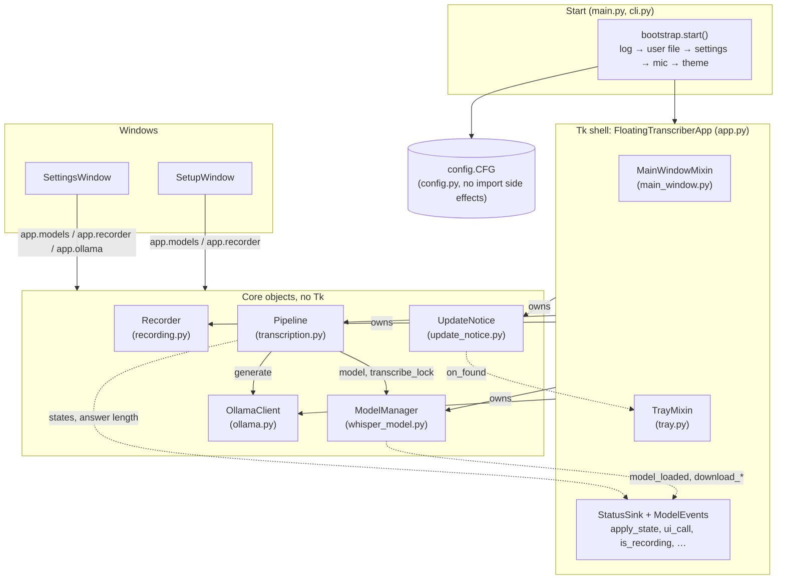
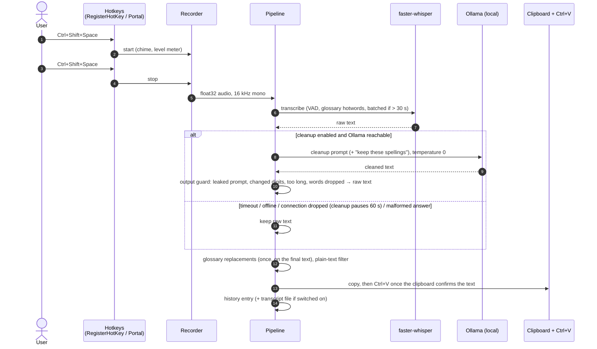

# Architecture

Hams is a Python tray application built with Tkinter. One process owns the hotkeys, the microphone, the Whisper
model and the UI. Ollama runs as a separate local service and is reached over HTTP on `127.0.0.1`.

## Structure

The Tk application is a thin shell around plain-Python objects that have no Tk. They report back through two small
interfaces the app implements, so tests build the real objects with fakes instead of a window.

| Object | Owns | Talks to the UI through |
|---|---|---|
| `Recorder` | the input stream, recorded blocks, level, microphone consumers (level meters), length limit | return values and `MicrophoneUnavailable`; the app shows the states |
| `ModelManager` | the Whisper model, load generations, fallback, download numbers | `ModelEvents` (`model_loaded`, `download_progress`, `download_finished`), always on the Tk thread via `ui_call` |
| `Pipeline` | the job queue, Whisper, cleanup and its guard, *Ask AI*, delivery | `StatusSink` (`apply_state`, `ui_call`, `is_recording`, `show_answer_length`) and `on_delivered` (tray history) |
| `OllamaClient` | every HTTP request to Ollama: generate (streamed or not), warm-up, tags, ps, pull | nothing; callers translate errors |
| `UpdateNotice` | the update check and the pending release | `on_found`, `on_change` callbacks |

The app keeps the decisions that are about the window: which state to show, holding a model message back until a
recording stops, the recording flow (start, stop, queue the job). Importing `hams.config` defines the settings and
nothing else; `hams.bootstrap` sets up the log, creates or migrates the user file, reads the settings into the one
`CFG` object in place, resolves the microphone and applies the colour scheme.

## Pipeline

Prompt mode follows the same path, but the recognised text goes to Ollama as a question, and the (streamed) answer
is pasted instead.

A new recording may start while the previous one is still in this pipeline. Each finished recording becomes a job
with its own prompt mode and run id; one worker thread handles the jobs in order, so every text is pasted and none
is lost. Only the newest run updates the main window, and never during a recording. The glossary replacements are
applied once, to the final text (in prompt mode to the prompt); the cleanup sees the raw text plus the glossary hint.
A catalog model that isn't cached is always fetched through the app's own download with progress, never by
faster-whisper's silent implicit download.

## Threads

| Thread | Owns |
|---|---|
| Tk main thread | all widgets; other threads hand callbacks over through `UiDispatcher` (see below) |
| Hotkey thread | Windows: a message loop with `RegisterHotKey`. Linux: a GLib main context for the portal's D-Bus signals |
| Audio callback | `sounddevice` stream; it only appends to a buffer and updates the RMS level |
| Worker threads | model loading/download, transcription, Ollama requests, so the UI never blocks |

Tkinter is not thread-safe, and `root.after(...)` from a foreign thread *blocks* that thread until the Tk thread
serves it. If the Tk thread is at the same moment joining that thread (the hotkey thread on shutdown or restart),
both wait. `ui_dispatch.UiDispatcher.call` therefore never touches Tk from another thread: it only puts the callback
into a queue, which the Tk thread drains every 20 ms, in order. After shutdown, late callbacks are dropped quietly.

## Modules

| Area | Modules | Notes |
|---|---|---|
| Entry and lifecycle | `main.py`, `instance.py`, `activation.py` | Single-instance mutex (Windows) or lock file (Linux); self-restart; `Hams.exe --settings` opens the settings of the running instance through a named event |
| App shell | `app.py`, `status.py`, `ui_dispatch.py`, `main_window.py`, `tray.py`, `window_position.py` | `FloatingTranscriberApp` is the main window and tray (two mixins) and owns the core objects (see *Structure*); it implements `StatusSink` and `ModelEvents` |
| Start | `bootstrap.py` | Log, user file, settings, microphone and colour scheme, in that order, called explicitly by `main.py` and `cli.py` |
| Audio | `recording.py`, `audio_devices.py` | `Recorder`; level meter in dBFS (−62 … −28 dB mapped to 0 … 1), peak normalisation for quiet input, auto-stop; device lists and name resolution |
| Speech recognition | `whisper_model.py`, `models.py`, `backend.py`, `backend_preload.py` | `ModelManager`. Device and precision fallback chain (`cuda: float16 → int8_float16 → int8`, then CPU). CUDA libraries are preloaded from the NVIDIA wheels or the app's download; `torch` is not a dependency. Every load (start, retry, switch, setup assistant, finished download) goes through one request with a generation number; phases `idle → loading`/`switching → ready`/`failed`. Loads run one after the other under the transcription lock, and only the newest generation may commit, so a late, superseded load is freed instead of replacing the newer choice |
| Post-processing | `transcription.py` (`Pipeline`), `cleanup_guard.py`, `ollama.py` (`OllamaClient`), `glossary.py`, `dictation_language.py`, `prompts/cleanup*.txt` | 30 s cleanup timeout with raw-text fallback; cleanup samples at temperature 0, and `cleanup_guard.py` strips a "Here is the corrected text:" line and replaces an answer that leaks the prompt, grows too much, changes digits or drops most words by the raw text; the glossary reloads when the file changes |
| Hotkeys | `system_hotkeys.py`, `portal_hotkeys.py`, `hotkey_editor.py` | `RegisterHotKey` survives standby, unlike low-level keyboard hooks that Windows silently removes |
| Linux integration | `linux.py`, `linux/*.sh` | `uinput` virtual keyboard, synthesised chime, `SIGUSR1` to bring the window to front, systemd user service |
| Settings | `settings_window.py`, `settings_sections.py`, `settings_shortcuts.py`, `settings_status.py`, `settings_models.py`, `settings_extras.py`, `settings_about.py` | Live microphone level, Ollama status, model download and delete, glossary, *About & help* |
| Support | `support.py`, `self_test.py`, `cli.py` | `--self-test` and `--report` for the installer and CI; in the app, a diagnostic report (self-test without the Tk check, plus the end of the log) written in a worker thread and opened in the default editor; links to the docs |
| Update notice | `updates.py`, `update_notice.py` | At most one request a day to the GitHub releases API in a background thread; only a notice with a link, never a download. `[updates] check = false` turns it off |
| Config | `config.py`, `config_toml.py`, `config_validation.py`, `config.default.toml` | No side effects on import (`bootstrap.py` loads). Three layers: code defaults → shipped defaults → user file. Writes go through `tomlkit` and keep comments and formatting; the result is re-read with `tomllib` before it replaces the file, atomically |
| Design system | `ui_kit/` | Theme tokens, DPI scaling, buttons, selects, popovers, icons, focus and hover states. Frozen: the package exports only what the app uses, and new screens are built from the existing controls instead of new hand-made ones |

## Design decisions

- **`127.0.0.1` instead of `localhost`.** On Windows, `localhost` resolves to `::1` first. Ollama listened on IPv4
  only, so every request first waited about 2 s for a refused IPv6 connection. See
  [evaluation.md](evaluation.md#where-the-time-went).
- **No `torch`.** CTranslate2 imports its converters unconditionally, and with `torch` and `transformers` in the
  same interpreter that cost 1.6 s per start and 4.3 GB on disk. Hams depends on neither: cuBLAS/cuDNN, which
  `torch` used to provide as a side effect, come from the `nvidia-*-cu12` wheels or the app's own download, and
  `backend_preload.py` registers them before faster-whisper is imported. (An earlier version also hid `torch`
  during that import for environments that happen to have it; the installer never does, so that was removed.)
- **`RegisterHotKey` instead of a keyboard hook.** Low-level hooks are dropped by Windows after standby or under
  load, and never come back. Registered hotkeys survive.
- **Batched inference only above 30 s.** Below that it brings no speed-up; above it, it is faster *and* more
  accurate, because sequential decoding dropped words on long audio.
- **Privacy.** Logs contain text lengths only. A remote Ollama endpoint must use HTTPS; plain HTTP is accepted only
  for the local machine (`config_validation.py`).

## Quality gates

- ≈1,800 test functions, ≈3,350 test cases including parametrisation. Many of them drive the real Tk application
  through `tests/live_app.py`, with fakes for the microphone, Whisper and Ollama; the core objects are tested
  directly with injected fakes (`make_pipeline`, `ready_models`, `RecordingSink`). Tests check behaviour, never the
  source text of a function; the only source scans are project-wide AST rules (catalog strings, theme colours,
  English identifiers and log messages).
- Coverage gates with branch coverage: 93 % on Windows (excludes the Linux-only modules, see `coverage-windows.ini`), 88 % on Linux (counts the Windows-only modules).
- ruff with pycodestyle, pyflakes, bugbear, bandit, import order and **max cyclomatic complexity 10**.
- Dependencies are locked with hashes (`uv pip compile --generate-hashes`), audited with `pip-audit`, and re-locked
  weekly by `.github/workflows/lock-refresh.yml` (one pull request for all three lock files). Dependabot only updates
  the GitHub Actions, which are pinned to commit SHAs.
- gitleaks scans the full git history for secrets.
