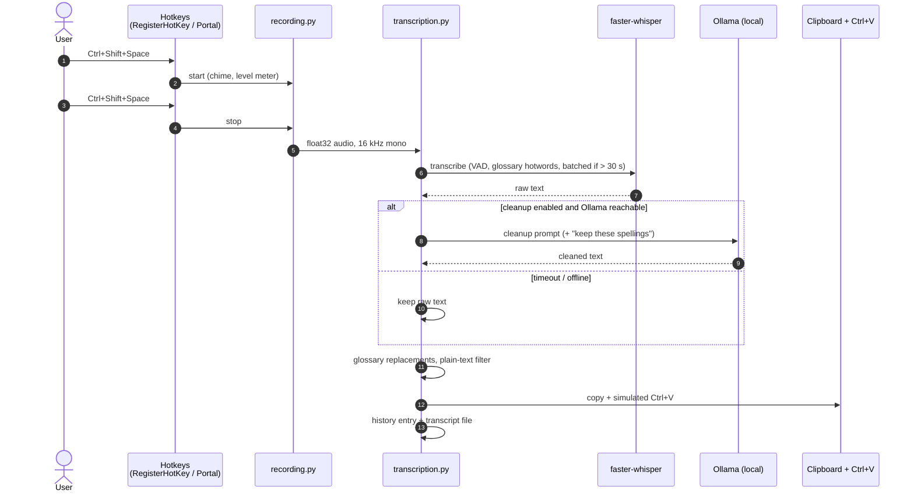

# Architecture

Hams is a Python tray application built with Tkinter. One process owns the hotkeys, the microphone, the Whisper
model and the UI. Ollama runs as a separate local service and is reached over HTTP on `127.0.0.1`.

## Pipeline

Prompt mode follows the same path, but the recognised text goes to Ollama as a question, and the (streamed) answer
is pasted instead.

## Threads

| Thread | Owns |
|---|---|
| Tk main thread | all widgets; other threads hand work over with `root.after(...)` |
| Hotkey thread | Windows: a message loop with `RegisterHotKey`. Linux: a GLib main context for the portal's D-Bus signals |
| Audio callback | `sounddevice` stream; it only appends to a buffer and updates the RMS level |
| Worker threads | model loading/download, transcription, Ollama requests, so the UI never blocks |

## Modules

| Area | Modules | Notes |
|---|---|---|
| Entry and lifecycle | `main.py`, `instance.py`, `activation.py` | Single-instance mutex (Windows) or lock file (Linux); self-restart; `Hams.exe --settings` opens the settings of the running instance through a named event |
| App shell | `app.py`, `main_window.py`, `tray.py`, `window_position.py` | `FloatingTranscriberApp` is composed of mixins (`MainWindowMixin`, `TrayMixin`, `WhisperModelMixin`, `RecordingMixin`, `TranscriptionMixin`) |
| Audio | `recording.py` | Level meter in dBFS (−62 … −28 dB mapped to 0 … 1), peak normalisation for quiet input, auto-stop |
| Speech recognition | `whisper_model.py`, `models.py`, `backend.py`, `backend_preload.py` | Device and precision fallback chain (`cuda: float16 → int8_float16 → int8`, then CPU). CUDA libraries are preloaded from the NVIDIA wheels, so `torch` is never imported |
| Post-processing | `transcription.py`, `ollama.py`, `glossary.py`, `dictation_language.py`, `prompts/cleanup*.txt` | 30 s cleanup timeout with raw-text fallback; the glossary reloads when the file changes |
| Hotkeys | `system_hotkeys.py`, `portal_hotkeys.py`, `hotkey_editor.py` | `RegisterHotKey` survives standby, unlike low-level keyboard hooks that Windows silently removes |
| Linux integration | `linux.py`, `linux/*.sh` | `uinput` virtual keyboard, synthesised chime, `SIGUSR1` to bring the window to front, systemd user service |
| Settings | `settings_window.py`, `settings_sections.py`, `settings_shortcuts.py`, `settings_status.py`, `settings_models.py` | Live microphone level, Ollama status, model download and delete |
| Update notice | `updates.py`, `update_notice.py` | At most one request a day to the GitHub releases API in a background thread; only a notice with a link, never a download. `[updates] check = false` turns it off |
| Config | `config.py`, `config_toml.py`, `config_validation.py`, `config.default.toml` | Three layers: code defaults → shipped defaults → user file. Writes keep comments and formatting |
| Design system | `ui_kit/` | Theme tokens, DPI scaling, buttons, selects, popovers, icons, focus and hover states |

## Design decisions

- **`127.0.0.1` instead of `localhost`.** On Windows, `localhost` resolves to `::1` first. Ollama listened on IPv4
  only, so every request first waited about 2 s for a refused IPv6 connection. See
  [evaluation.md](evaluation.md#where-the-time-went).
- **No `torch`.** CTranslate2 imports its converters unconditionally. With `torch` and `transformers` in the same
  interpreter, that cost 1.6 s per start and 4.3 GB on disk. `backend_preload.py` hides `torch` and `transformers`
  just for the duration of that import (CTranslate2 treats "torch missing" as a supported state). It then loads
  cuBLAS/cuDNN from the `nvidia-*-cu12` wheels, which `torch` used to provide as a side effect.
- **`RegisterHotKey` instead of a keyboard hook.** Low-level hooks are dropped by Windows after standby or under
  load, and never come back. Registered hotkeys survive.
- **Batched inference only above 30 s.** Below that it brings no speed-up; above it, it is faster *and* more
  accurate, because sequential decoding dropped words on long audio.
- **Privacy.** Logs contain text lengths only. A remote Ollama endpoint must use HTTPS; plain HTTP is accepted only
  for the local machine (`config_validation.py`).

## Quality gates

- About 1,600 pytest tests. Many of them drive the real Tk application through `tests/live_app.py`, with fakes for
  the microphone, Whisper and Ollama.
- Coverage gate of 85 % (Windows CI excludes the Linux-only modules, see `coverage-windows.ini`).
- ruff with pycodestyle, pyflakes, bugbear, bandit, import order and **max cyclomatic complexity 10**.
- Dependencies are locked with hashes (`uv pip compile --generate-hashes`), audited with `pip-audit`, and updated by
  Dependabot. GitHub Actions are pinned to commit SHAs.
- gitleaks scans the full git history for secrets.
